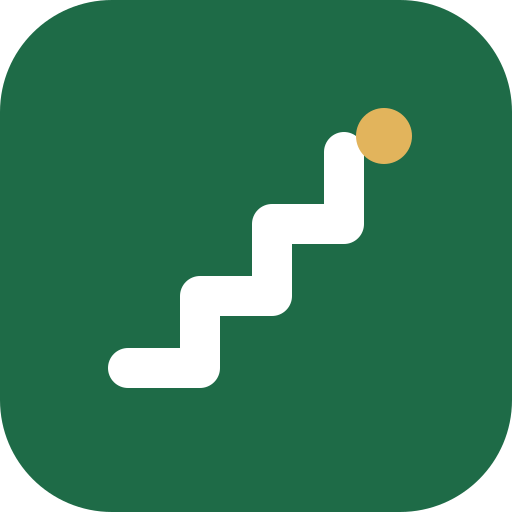
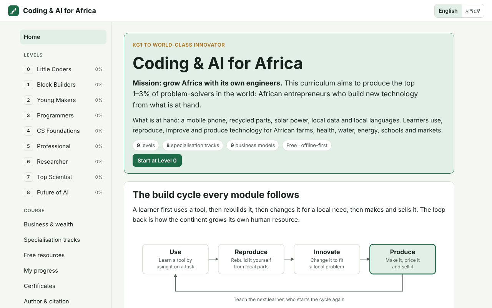
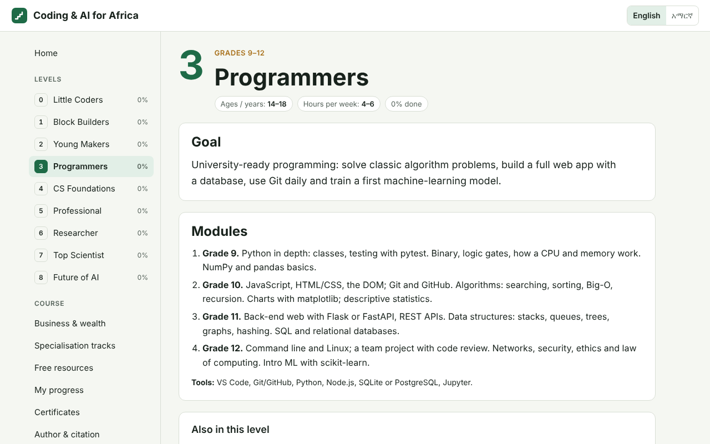
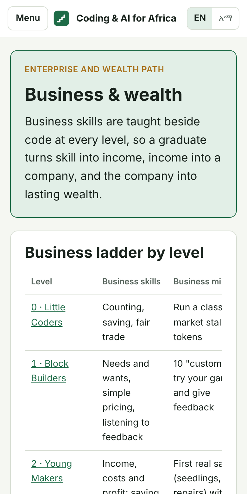
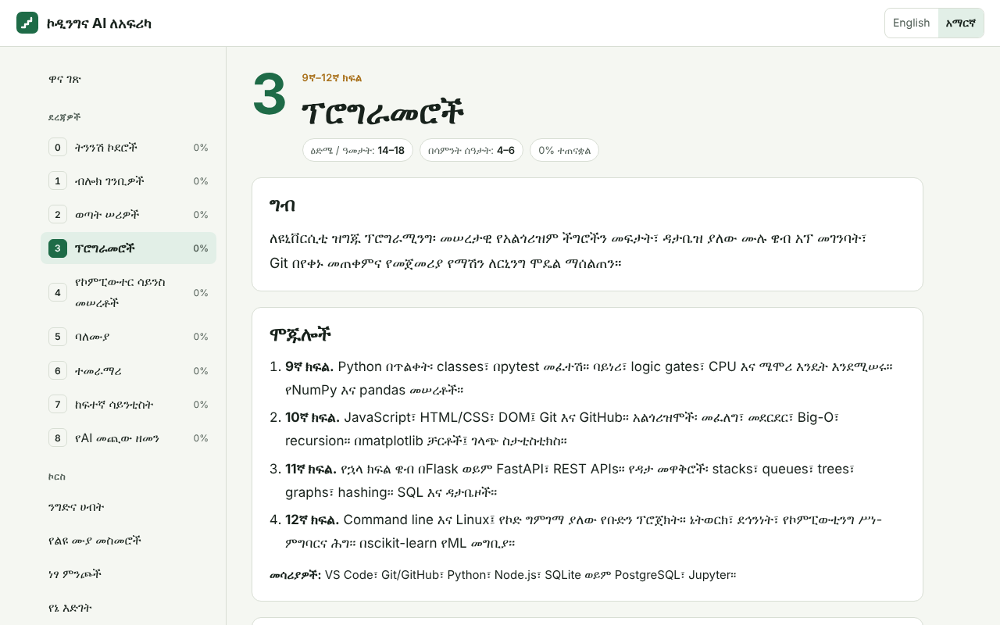

# Coding & AI for Africa

**Build, Solve, Create: KG1 to World-Class Innovator**

A free, offline-first coding and AI curriculum that grows Africa with its own engineers and entrepreneurs.

**ኮዲንግና AI ለአፍሪካ** · ከKG1 እስከ ዓለም አቀፍ ፈጣሪ የሚያደርስ ነፃ፣ ያለ ኢንተርኔት የሚሠራ የኮዲንግና የAI ሥርዓተ ትምህርት · ሙሉ በሙሉ በእንግሊዝኛና በአማርኛ

---

## Mission

**Grow Africa with its own engineers.** This curriculum aims to produce the top 1–3% of problem-solvers in the world: African entrepreneurs who build new technology from what is at hand.

What is at hand: a mobile phone, recycled parts, solar power, local data and local languages. Learners **use, reproduce, innovate and produce** technology for African farms, health, water, energy, schools and markets, then teach the next learner.

## The 9 levels

| Level | Name | Stage | Ages | Learner leaves able to… |
| :---: | --- | --- | --- | --- |
| 0 | Little Coders | KG1–KG3 | 4–6 | Give and follow exact step-by-step instructions |
| 1 | Block Builders | Grades 1–4 | 6–10 | Build a Scratch game with loops, events and variables |
| 2 | Young Makers | Grades 5–8 | 10–14 | Write 100-line Python programs, a website and a device project |
| 3 | Programmers | Grades 9–12 | 14–18 | Solve algorithms, build a data-driven web app, train a first ML model |
| 4 | CS Foundations | BSc years 1–3 | 18–21 | Reason about algorithms, systems and the maths behind ML |
| 5 | Professional | BSc + 1–3 years work | 21–25 | Ship and maintain production software and AI services |
| 6 | Researcher | MSc + PhD | 22–30 | Publish peer-reviewed research and release open tools |
| 7 | Top Scientist | Postdoc → PI | 28+ | Set a research agenda, lead a lab, build a company |
| 8 | Future of AI | Lifelong | Any | Anticipate and shape where AI goes next |

Each level has a **goal, modules, tools, a signature project, an Africa challenge & enterprise step, a business milestone, an exit test, a practice checklist and free resources**. Learners move up by passing the exit test, not by age.

  
  &nbsp;
  

## Fully bilingual: English and አማርኛ

Every page switches between English and Amharic with one tap: all 9 levels, modules, projects, exit tests, business models, wealth rules, tracks, resources and certificates. Technical names (Python, Scratch, Git) stay in English, following the curriculum's own rule: *mother tongue first, English for code words*.

## What makes it different

- **Problem first:** every project starts from a real local problem.
- **Frugal by default:** phones, recycled electronics, solar power and free open-source software.
- **Offline first:** the app and every project work without internet.
- **Mother tongue first:** ideas taught in local languages, English for code words.
- **A user and a price:** every project names who uses it and who pays.
- **Teach back:** each graduate trains at least five learners below them.
- **Enterprise and wealth path:** a business milestone at every level, 9 high-profit models that start small, and rules for turning profit into wealth.

## Use it

| Where | How |
| --- | --- |
| Online | Open **https://muler-21.github.io/coding-ai-africa/** |
| Offline | Visit once online and it keeps working without internet. On a phone, choose *Add to Home screen* to install it like an app. |
| No internet at all | Download `index.html` and open it in any browser. |

No accounts and no personal data. Progress ticks stay in the learner's own browser and can be moved to another device with a progress code. Visits are counted anonymously.

## Repository files

| File | Purpose |
| --- | --- |
| `index.html` | The whole app: content, layout and logic in one file |
| `sw.js` | Offline cache |
| `manifest.webmanifest`, `icon.svg` | Install as a phone app |
| `CITATION.cff` | Citation metadata for GitHub and Zenodo |
| `LICENSE.md` | CC BY-NC 4.0 |
| `docs/` | Screenshots |

## Contribute

Teachers, translators and engineers are welcome. The most useful help right now:

1. **Translations** into Afaan Oromo, Tigrinya, Swahili, Hausa, Yoruba and other African languages.
2. **Review of the Amharic text** by teachers, so wording fits classrooms.
3. **Lesson plans** and worksheets for any level.
4. **Local project ideas** that solve real problems with low-cost materials.

Open an issue or a pull request.

## Author

**Mulusew Kassa Bitew**
Postdoctoral Research Fellow, University of Molise, Italy
Department of Plant Science, College of Agriculture and Natural Resources, Debre Markos University, Ethiopia

ORCID: [0000-0001-6223-0037](https://orcid.org/0000-0001-6223-0037) · GitHub: [@Muler-21](https://github.com/Muler-21) · Website: [muler-21.github.io](https://muler-21.github.io)

**Other apps:** [AdaptFit](https://muler-21.github.io/apps/adaptfit) · [Sebel Hakim](https://muler-21.github.io/sebel-hakim) · [AMBKidsJoy](https://muler-21.github.io/AMBKidsJoy/) · [Research Integrity Compass](https://github.com/Muler-21/Research-Integrity-Compass-)

## How to cite

> Bitew, M. K. (2026). *Coding & AI for Africa: Build, Solve, Create (KG1 to World-Class Innovator)* [Curriculum and web app]. https://github.com/Muler-21/coding-ai-africa

GitHub shows a **Cite this repository** button from `CITATION.cff`.

---

© 2026 Mulusew Kassa Bitew · Licensed under [CC BY-NC 4.0](LICENSE.md)
